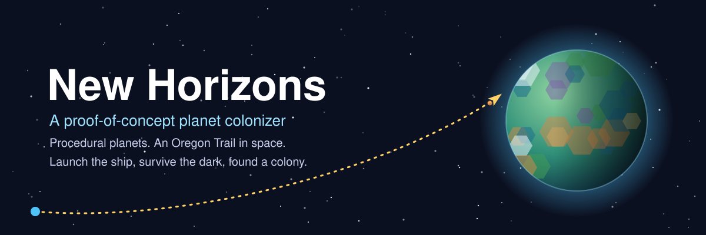
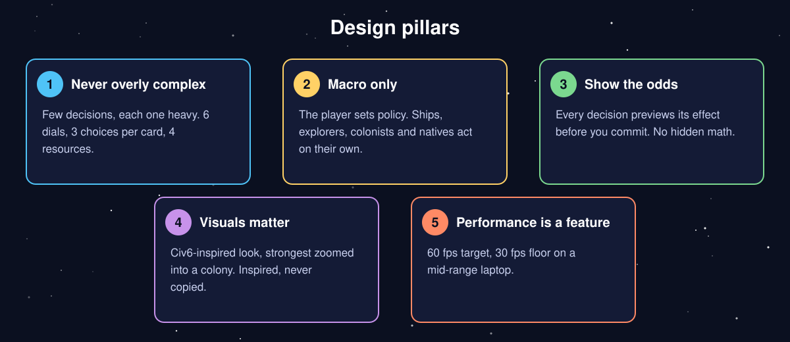
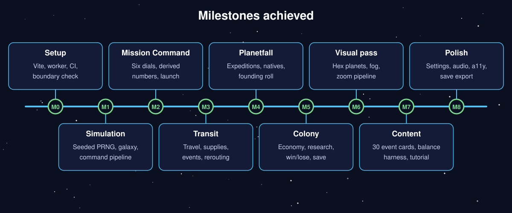
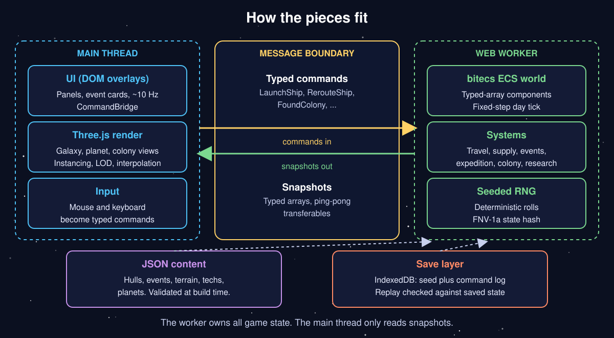

# New Horizons POC

**A proof-of-concept planet colonizer: launch the ship, survive the dark, found a colony.**



## About

New Horizons POC is a browser strategy game in the spirit of "Oregon Trail in space", a macro 4X. You are a mission director. You pack and launch colony ships, answer event cards on the way, and found colonies on procedurally generated planets. You never control individual units.

Every launch is a gamble. You split a fixed cargo capacity across six dials (passengers, supplies, fuel, speed, survey kit, security) and watch ETA, supply margin and founding odds update before you commit. In flight you can reroute a ship to any planet inside its fuel range. In orbit you send down an expedition, reveal a hex region map over rounds of dice-driven exploration, and make one call: found a colony or re-embark and leave. Some planets host natives, whose disposition stays hidden until your expedition makes contact.

The goal is to build a self-sustaining colony network before the homeworld collapses. A run is meant to last about 90 to 150 minutes.

This repository contains the full source of the playable game (codebase working title "Colony Ship").

## Goals

The design rests on five pillars.



- **Never overly complex.** Hard limits: at most 6 loadout dials, 3 choices per event card and 4 resources. A new mechanic must replace or merge with an existing one.
- **Macro only.** The player sets policy; the simulation does the rest.
- **Show the odds.** Uncertainty comes from incomplete planet data, never hidden math.
- **Visuals matter.** A Civ6-inspired look, inspired by and never copied from, with original assets only.
- **Performance is a feature.** 60 fps target and a 30 fps floor on a mid-range laptop.

## What's been achieved

The implementation plan runs from M0 to M8. M0 to M5 are checked off in the plan, and the decision log records the M6 to M8 work (visual pass, content and balance tooling, polish). The full launch-to-colony loop is playable.



- **M0 to M2.** Project setup with CI and a boundary check; the seeded simulation skeleton and galaxy generator; Mission Command with six dials and shared launch math.
- **M3 to M5.** Ships in transit (travel, supplies, events, rerouting, survey on approach); planetfall with expeditions, natives and the founding roll; colony economy, spaceports, research, win and lose conditions, and save and load.
- **M6.** A single UI theme, galaxy art, hex planet terrain with props, districts and fog, and a zoom pipeline from galaxy to system to orbit to colony.
- **M7.** A 30-card event set (12 transit, 12 exploration, 6 native contact), a headless balance harness with six archetype bots, a guided tutorial, and a longer run clock.
- **M8.** Settings, synthesised audio, keyboard and screen-reader basics, colour-blind-safe palettes, a performance pass, a static-site production build, an error log, and save export and import.

A recorded balance sweep (40 seeds per archetype, 240 runs) puts win rates between 13% and 53%. All but one of the harness's band checks pass; the Gambler's first-roll founding rate is a known miss. The win condition is 10 colonies of 2,600 or more people held for 90 days, against an 8,000-day homeworld clock.

## Technical scope



- **Stack:** TypeScript (strict), Vite, Three.js (WebGL2), bitecs, Vitest, ESLint, Prettier and dependency-cruiser. No server, no network calls, no analytics.
- **Sim and render split.** The simulation runs in a Web Worker and owns all game state. The main thread renders and handles UI from snapshots, and never writes sim state. Player input becomes typed commands that the worker validates and logs.
- **Determinism.** A project-owned seeded PRNG, with no `Math.random` or clocks in the sim. The same seed plus the same command log gives the same state hash (FNV-1a), which is the basis for replay and bug reports.
- **Data-driven content.** Hulls, speeds, terrain, events, techs and planet types are JSON files validated at build time.
- **Rendering.** Instanced meshes for stars and ships, chunked hex terrain, one fog texture, level of detail by zoom, and no per-frame allocations in render loops.
- **Saves.** A save is the seed plus the command log, stored in the browser (IndexedDB) and replayed on load; it can also be exported to and imported from a `.json` file.
- **Tests and CI.** About 60 Vitest suites cover the sim, determinism and replay, content, balance, render logic and UI models. CI runs typecheck, lint, the dependency boundary check, tests and the production build.

The source is about 140 files across `src/sim`, `src/worker`, `src/shared`, `src/data`, `src/render` and `src/ui`.

## Getting started

Requires Node.js. Install dependencies with `npm install`, then:

```
npm run dev       # Vite dev server; add ?debug for the frame overlay, ?seed=123 for a fixed galaxy
npm test          # Vitest
npm run build     # type check, then the production build into dist/
npm run preview   # serve dist/ locally
npm run ci        # typecheck, lint, dependency rules, tests, build
```

WebGL2 is required. The build is plain static files and can be hosted on any static host.

## Repository layout

```
src/sim      ECS simulation (runs in the Web Worker, no DOM or Three.js)
src/worker   worker entry and message handling
src/shared   types and pure logic shared by sim and UI
src/data     JSON content and its validator
src/render   Three.js galaxy, system and planet views
src/ui       DOM panels, HUD and view models
tests        Vitest suites
smoke        headless-browser smoke scripts
docs         design, architecture, balance and decision log
```

Developer notes: [docs/DEVELOPER.md](docs/DEVELOPER.md). Design: [GAME_DESIGN](docs/GAME_DESIGN.md), [ARCHITECTURE](docs/ARCHITECTURE.md), [DECISIONS](docs/DECISIONS.md), [BALANCE](docs/BALANCE.md).

## License

This work is dedicated to the public domain under the [CC0 1.0 Universal](LICENSE) dedication. You can copy, modify and distribute it, including for commercial purposes, without asking permission.
